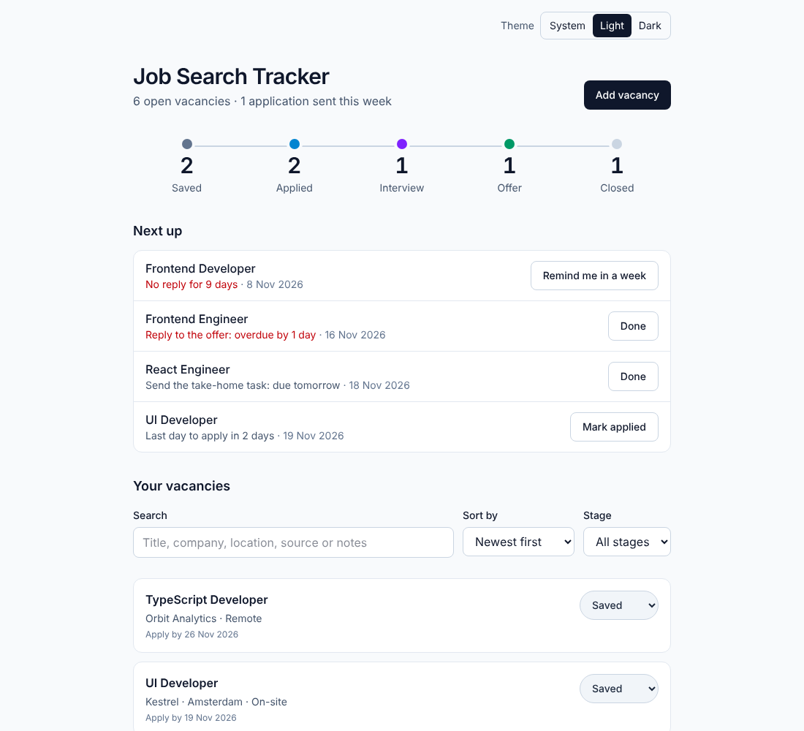
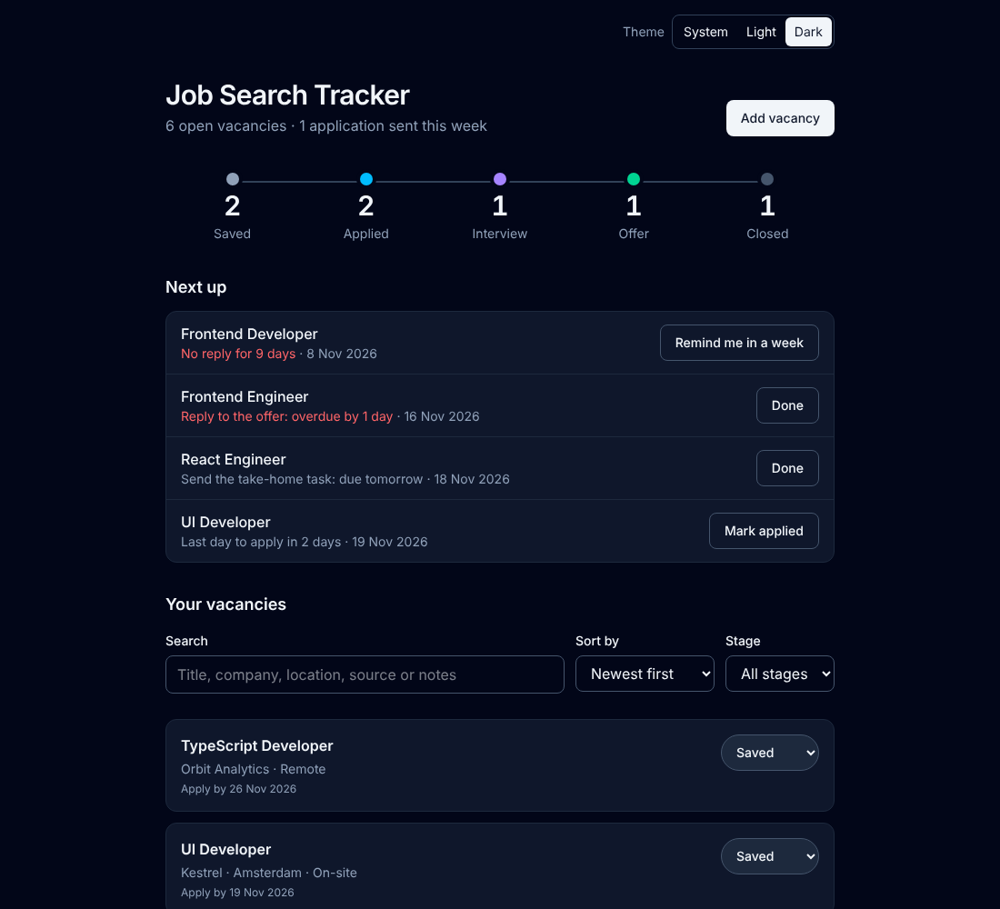
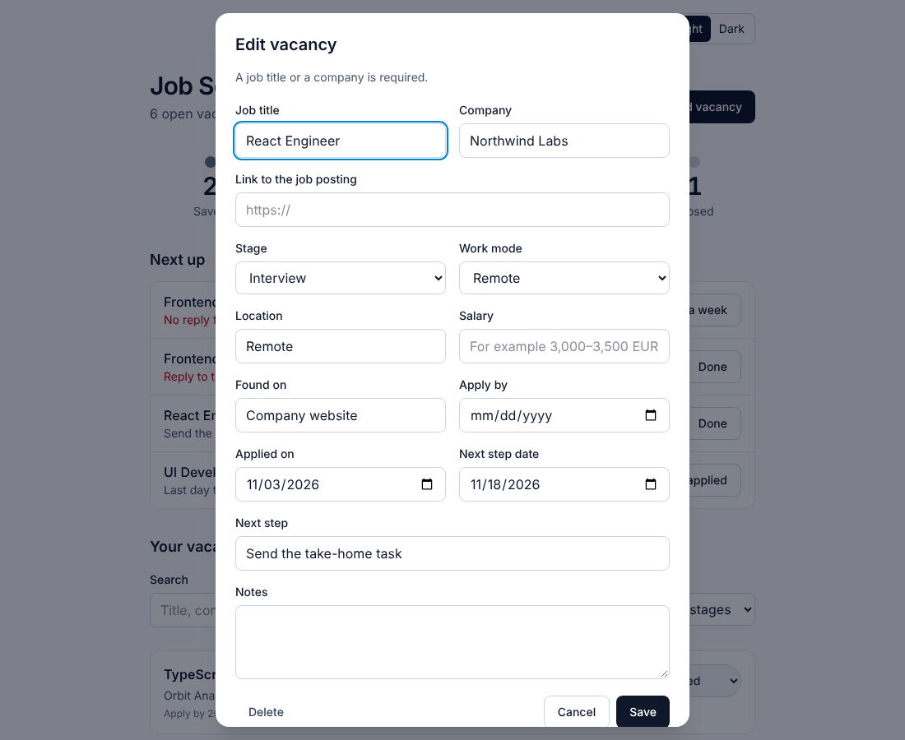
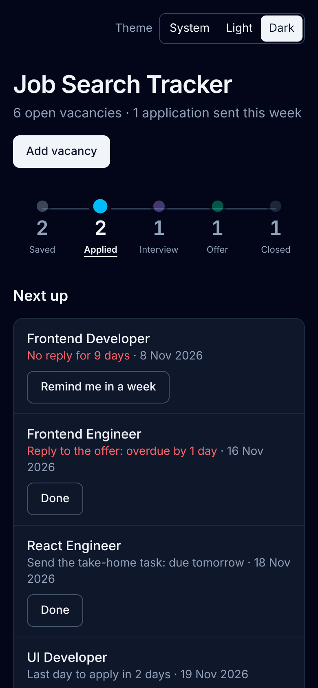
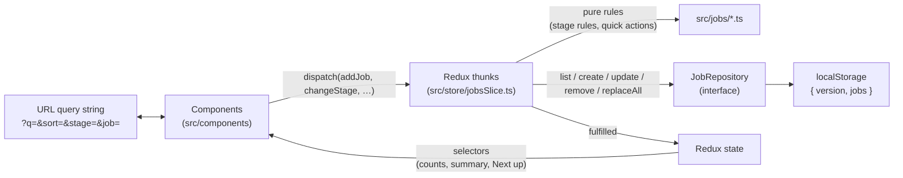

# Job Search Tracker

[](https://github.com/nurlanmusayev2000/job-tracker/actions/workflows/ci.yml)
[](https://github.com/nurlanmusayev2000/job-tracker/actions/workflows/deploy.yml)

A web app for one person to track their job applications: what they saved, where they applied, and what to do
next. There is no account and no server. Everything stays in your browser.

**[Live demo →](https://nurlanmusayev2000.github.io/job-tracker/)**

## Why

During a job search, the hard part isn't remembering where you applied. It's remembering to follow up, noticing
that a deadline is close, and seeing how the search is going. A spreadsheet can store the data but doesn't
remind you of anything. This app keeps the same data and tells you what needs attention next.

I also built it as a portfolio project, so the code, tests and decisions are meant to be read. Each part is small
enough to explain, and the [decisions](#decisions-and-trade-offs) section says why it is built this way.

## Screenshots



| Dark mode                                                        | Editing a vacancy                                                     | On a phone                                                                               |
| ---------------------------------------------------------------- | --------------------------------------------------------------------- | ---------------------------------------------------------------------------------------- |
|  |  |  |

## Features

- **Vacancies:** add, edit and delete a vacancy in a dialog, with its title, company, link, location, work mode,
  salary, source, notes and dates. A title or a company is required, and a link must start with http(s).
  Deleting asks first.
- **Five stages:** Saved, Applied, Interview, Offer, Closed. Change the stage from the list or the dialog.
- **Stage rules:** moving to Applied fills in today's date and plans "Follow up if there is no reply" a week
  later. Moving to Closed removes the next step.
- **Pipeline:** the stages drawn as stops on one line, each with its count. Click a stop to show only that stage.
- **Next up:** what needs attention within 3 days, most urgent first, each with one quick action:

  | Situation                                    | Quick action        |
  | -------------------------------------------- | ------------------- |
  | A next step is due within 3 days, or overdue | Done                |
  | Saved, and the deadline is within 3 days     | Mark applied        |
  | Saved, and the deadline has passed           | Close it            |
  | Applied 7+ days ago, with no next step       | Remind me in a week |

- **Summary:** open vacancies and applications sent this week (Monday to today).
- **Search, sort and filter:** search the title, company, location, source and notes. Sort by newest, soonest
  date or company A–Z. Search, sort, stage and the open vacancy are kept in the URL, so a reload or a shared
  link shows the same view.
- **Export and import:** download everything as a JSON file, and import it again. A bad file is refused with a
  message that says what is wrong.
- **Theme:** light, dark, or follow the system.
- **Accessible:** works with the keyboard alone, with visible focus and a skip link. Screen readers hear the
  stage counts, errors and search results. Animations turn off when the system asks for less motion. Checked
  with axe-core against WCAG 2.2 AA.
- **Small screens:** works from 320px wide.

## Tech stack

| Area      | Tools                                                                   |
| --------- | ----------------------------------------------------------------------- |
| Framework | Next.js 16 (App Router, static export), React 19, TypeScript 6 (strict) |
| State     | Redux Toolkit with React Redux                                          |
| Styling   | Tailwind CSS 4                                                          |
| Data      | localStorage behind a repository interface, checked with Zod            |
| Tests     | Vitest + React Testing Library (147 tests), one Playwright smoke test   |
| Quality   | ESLint, Prettier, GitHub Actions (CI on every pull request)             |
| Hosting   | GitHub Pages, deployed by GitHub Actions on every push to `main`        |

## How it works

### Data flow



1. A component dispatches a thunk, for example `changeStage({ id, stage: "applied" })`.
2. The thunk asks a pure function what should change (`changesForStage` adds the application date and the
   follow-up), then saves it through the `JobRepository`.
3. The repository checks the job with the Zod schema and writes `{ version, jobs }` to localStorage.
4. The reducer puts the saved job in the state. Memoized selectors compute the stage counts, the summary
   and "Next up", and the list re-renders.

Search, sort, stage filter and the open vacancy aren't in Redux. They live in the URL query string, read with
`useSyncExternalStore` and changed with `history.replaceState`.

### Folder structure

```
src/
├── app/              Next.js entry: the layout (with the theme script) and the one page
├── components/
│   ├── jobs/         The page and its parts: pipeline, Next up, list, dialog, data panel
│   └── ui/           Small reusable parts: Button, Dialog, Field, Alert, ThemeSwitch
├── jobs/             The domain, as pure functions: the Job type, Zod schema, saved-data
│                     versions, repository, stage rules, Next up, search/sort, import/export
├── lib/              General helpers: date math, the URL query string, the theme, downloads
├── messages/         All user-facing text (en.ts), so another language can be added
├── store/            Redux: the jobs slice with its thunks and selectors, the store, hooks
└── test/             Test helpers: sample jobs, an in-memory storage, renderApp
e2e/                  The Playwright smoke test
scripts/              A small static server that serves out/ the way GitHub Pages does
```

Tests sit next to the code they test, as `*.test.ts(x)`.

## Decisions and trade-offs

**Why a static export.** The app has no server, so `next build` with `output: "export"` produces plain HTML,
CSS and JavaScript that GitHub Pages hosts for free. The cost is that some Next.js features can't be used:
dynamic route segments, server actions and API routes. The app doesn't need them. The vacancy dialog uses a
query parameter (`?job=…`) instead of a route like `/jobs/[id]`. The page is built without any saved data, so
the app reads localStorage only after it mounts and shows a skeleton until then, which avoids hydration
mismatches.

**Why a repository interface.** The UI never touches localStorage. It calls a `JobRepository` with five async
methods. localStorage answers instantly, so the async methods look unnecessary today. But a REST API could
replace the localStorage version without changing a single component or thunk. It also makes testing simple:
the tests use the same repository with an in-memory storage and a fixed clock.

**Why Redux Toolkit for a small app.** `useState` and context could hold one list. Redux Toolkit earns its
place here because:

- Every change goes through one place (the thunks), where the stage rules and the repository are applied.
- The repository and "today" are passed in as the thunk's extra argument, so tests control both.
- `createSelector` keeps the derived data (counts, summary, "Next up") as memoized pure functions.

The cost is more files and concepts. For a team project it is also the most common state library, which
matters for a portfolio.

**Dates as local calendar strings.** A deadline is a day, not a moment, so dates are stored as `"YYYY-MM-DD"`.
The date math (today, add days, days between, start of the week) is in pure functions that treat each date as
midnight UTC, so daylight saving time can't shift a day. The tests run in New York time on purpose, to catch
mistakes that a UTC machine would hide.

**Versioned, validated data.** Saved data carries a format version, and old formats are updated step by step
before use. Everything read from storage or an imported file is checked with Zod. Data that can't be read is
never overwritten, so a bug can't silently delete someone's vacancies.

**Built on what the browser already does.** The dialog is the native `<dialog>` element, which already
handles focus, Escape and returning focus. The theme switch and stage filter use native radio buttons and
toggle buttons. This needed less code and fewer packages, with better accessibility.

**Import replaces, it doesn't merge.** Merging needs rules for conflicts (the same vacancy changed in two
places). The main uses are a backup and moving to another browser, so import replaces everything after a
clear confirmation.

## Run it locally

You need Node.js 22 or later.

```bash
npm install
npm run dev
```

Then open http://localhost:3000. Your data is saved in that browser's localStorage.

## Test it

```bash
npm test              # unit and component tests (Vitest)
npm run lint          # ESLint
npm run typecheck     # TypeScript
npm run build         # the static site, in out/
```

The Playwright smoke test builds the site with the GitHub Pages base path, serves it and runs it in Chromium.
Install the browser once first:

```bash
npx playwright install chromium
npm run test:e2e
```

| Script                 | What it does                                     |
| ---------------------- | ------------------------------------------------ |
| `npm run dev`          | Start the development server                     |
| `npm run build`        | Build the static site into `out/`                |
| `npm test`             | Run the unit and component tests once            |
| `npm run test:watch`   | Run them again on every change                   |
| `npm run test:e2e`     | Build the site and run the Playwright smoke test |
| `npm run lint`         | Check the code with ESLint                       |
| `npm run typecheck`    | Check the TypeScript types                       |
| `npm run format`       | Format every file with Prettier                  |
| `npm run format:check` | Check the formatting without changing files      |

**Continuous integration:** every pull request runs lint, the format check, the type-check, the tests, the
build and the smoke test. Every push to `main` deploys to GitHub Pages. The deploy builds with the base path
`/job-tracker`, and the smoke test serves the site under that same path, so a broken asset link fails before it
goes live.

## Roadmap

- Sync between devices, with a REST API behind the existing `JobRepository` interface.
- Merge an imported file with the saved vacancies, instead of replacing them.
- A second language, from a copy of `src/messages/en.ts`.
- Reminders as browser notifications when a next step is due.
- Update "Next up" at midnight while the page stays open (today it updates on the next reload).
- A history of stage changes for each vacancy, with response-rate statistics.

## License

[MIT](LICENSE)
